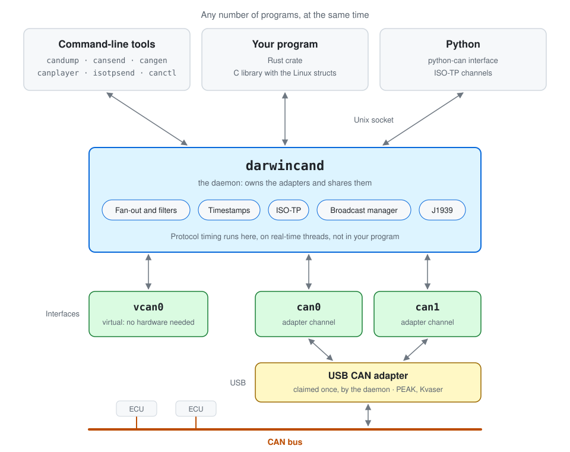

# darwinCAN

**SocketCAN-style CAN bus access for macOS.**

macOS has no CAN stack, and it lets only one process claim a USB adapter, so on a Mac a CAN adapter normally belongs to a single application. darwinCAN puts a small daemon in that position: `darwincand` owns the adapters, exposes each channel as a named interface (`can0`, `vcan0`), and shares it between any number of programs, each with its own filters, as SocketCAN does on Linux.

<picture>
  <source media="(prefers-color-scheme: dark)" srcset="docs/images/architecture-dark.svg">
  
</picture>

## What it gives you

- **The tools you know from Linux**: `candump`, `cansend`, `cangen`, `canplayer`, `cansniffer`, `isotpsend`, `isotprecv`, `isotpdump` and the J1939 tools (`j1939acd`, `j1939spy`, `j1939cat`, `j1939sr`, `testj1939`), with the can-utils command lines and output, and `canctl link ...` in place of `ip link ...`.
- **Several programs on one adapter at once**: a logger beside your application, `candump` beside your test.
- **Libraries for Rust, C and Python.** The C library uses the structs and constants of `<linux/can.h>`; the Python package is a [python-can](https://python-can.readthedocs.io) interface.
- **Protocols run by the daemon**: ISO-TP (ISO 15765-2) for UDS and OBD-II, cyclic messages and change detection (`CAN_BCM`), and SAE J1939 with its transport protocols (`CAN_J1939`).
- **Timing you can rely on.** Frames are timestamped once, from the adapter's own clock. A frame you send is reported when it was really on the bus. ISO-TP's STmin, cyclic messages and J1939 transport are timed on real-time threads in the daemon, independent of when your program runs.
- **Virtual interfaces** (`vcan0`) for developing and testing with no hardware attached.
- **No kernel extension, no driver, no root.**

darwinCAN is not the Linux kernel interface. There is no `AF_CAN` socket family, and a program that calls `socket(PF_CAN, ...)` does not build unchanged. What carries over is the model and the data, so porting a program means replacing its socket calls and keeping the rest.

## Status

**darwinCAN is at version 0.1.** It is usable and has been tested on real buses with adapters from two makers, but it is not yet stable: programming interfaces may still change, and the daemon and the programs that talk to it must come from the same build. See [docs/roadmap.md](docs/roadmap.md) for what works, what is planned, and the known limitations.

To build it you need macOS, the Xcode command line tools, and Rust 1.85 or later. It has been developed and tested on macOS 26 on Apple silicon; older macOS versions and Intel Macs are expected to work but have not been tested.

## Quick start

```sh
git clone https://github.com/b3rtoz/darwincan
cd darwincan
cargo build --release
export PATH="$PWD/target/release:$PATH"

darwincand &                                   # the daemon; creates vcan0
candump vcan0 &
cansend vcan0 123#DEADBEEF
cansend vcan0 123##1112233445566778899AABBCC   # CAN FD with bit rate switching
cangen vcan0 -g 10 -n 100                      # random test traffic

isotprecv -s 7E8 -d 7E0 vcan0 &
echo 22 F1 90 | isotpsend -s 7E0 -d 7E8 vcan0
```

With an adapter plugged in:

```sh
canctl link show
canctl link set can0 up type can bitrate 500000
candump can0
```

To install the daemon, the tools and the C library, and have the daemon start at login:

```sh
sudo make install        # into /usr/local; or: make install PREFIX=$HOME/.local
darwincand install       # registers a launch agent for your user
```

## Supported hardware

| Adapters                                                                                                                  | Driver           | Tested on                           |
| ------------------------------------------------------------------------------------------------------------------------- | ---------------- | ----------------------------------- |
| PEAK PCAN-USB FD, PCAN-USB Pro FD, PCAN-USB X6, PCAN-Chip USB                                                             | `peak_fd`      | PCAN-USB X6: classic CAN and CAN FD |
| PEAK PCAN-USB (classic CAN)                                                                                               | `pcan_usb`     | IPEH-002021                         |
| Kvaser USBcan Light 4xHS, USBcan Pro, Leaf Pro HS v2, Leaf v3, U100, Memorator Pro, Hybrid and the other "hydra" adapters | `kvaser_hydra` | USBcan Light 4xHS: classic CAN      |

Models other than those named under "Tested on" are supported by the same driver but have not been tried. [docs/hardware.md](docs/hardware.md) has the details: what each adapter can do, what was tested, measured timing, and how to report on an adapter you have.

## Using it from your own program

Rust:

```rust
use darwincan::{Filter, Frame, Id, IsoTpParams, IsoTpSocket, RawSocket};

let can = RawSocket::open("vcan0")?;
can.set_filters(&[Filter::new(0x100, 0x700)])?;
can.send(&Frame::new(Id::Standard(0x123), &[0xDE, 0xAD])?)?;
let rx = can.recv()?;
println!("{} at {} ns", rx.frame, rx.timestamp_ns);

let uds = IsoTpSocket::open("vcan0", IsoTpParams::new(0x7E0, 0x7E8))?;
uds.send_blocking(&[0x22, 0xF1, 0x90])?;
let response = uds.recv()?;
```

C, with the Linux structs and constants:

```c
#include <darwincan.h>

dcan_raw *can = dcan_raw_open("vcan0");
struct can_frame tx = { .can_id = 0x123, .len = 2, .data = { 0xDE, 0xAD } };
dcan_raw_send(can, &tx);

struct canfd_frame rx;
struct dcan_rx_info info;
if (dcan_raw_recv(can, &rx, &info, 1000) > 0)   /* wait at most a second */
        printf("%X [%d] at %llu ns\n", rx.can_id, rx.len, info.timestamp_ns);
```

Python, through python-can:

```python
import can

with can.Bus(interface="darwincan", channel="can0", bitrate=500000) as bus:
    bus.send_periodic(can.Message(arbitration_id=0x100, data=[0, 0], is_extended_id=False), 0.010)
    print(bus.recv(timeout=1))
```

## Documentation

| If you want to                                                          | Read                                                                            |
| ----------------------------------------------------------------------- | ------------------------------------------------------------------------------- |
| Run the daemon and use the command-line tools, or move over from can-utils | [docs/tools.md](docs/tools.md)                                                   |
| Build an application on darwinCAN in any language, or use the Rust library | [docs/application-guide.md](docs/application-guide.md)                           |
| Use the C library, or port a SocketCAN program                          | [docs/c-api.md](docs/c-api.md)                                                   |
| Use python-can                                                          | [docs/python.md](docs/python.md)                                                 |
| Know which adapters work and how they behave                            | [docs/hardware.md](docs/hardware.md)                                             |
| Understand how it works and why                                         | [docs/design.md](docs/design.md)                                                 |
| Work on darwinCAN itself, or add an adapter                             | [docs/development.md](docs/development.md) and [CONTRIBUTING.md](CONTRIBUTING.md) |
| See what is planned                                                     | [docs/roadmap.md](docs/roadmap.md)                                               |

## Contributing

Bug reports, reports of how an adapter behaves, and pull requests are welcome; see [CONTRIBUTING.md](CONTRIBUTING.md). A report from an adapter that is listed as untested is especially useful.

The daemon trusts every program that can open its socket, which by default means every program running as you. [SECURITY.md](SECURITY.md) explains what that means when an adapter is connected to a vehicle or a machine, and how to report a vulnerability.

## Licence

The daemon (`crates/darwincand`) is licensed under GPL-2.0-only, because its hardware backends are derived from the Linux kernel's CAN drivers.

Everything an application uses (the client library in Rust and C, the protocol crates, the tools and the Python package) is licensed under either of [MIT](LICENSE-MIT) or [Apache-2.0](LICENSE-APACHE), at your option. A program talks to the daemon over a socket and does not link it, so an application built on darwinCAN may use any licence.

darwinCAN is not affiliated with PEAK-System, Kvaser or the Linux SocketCAN project. Product names are their owners' trademarks.
