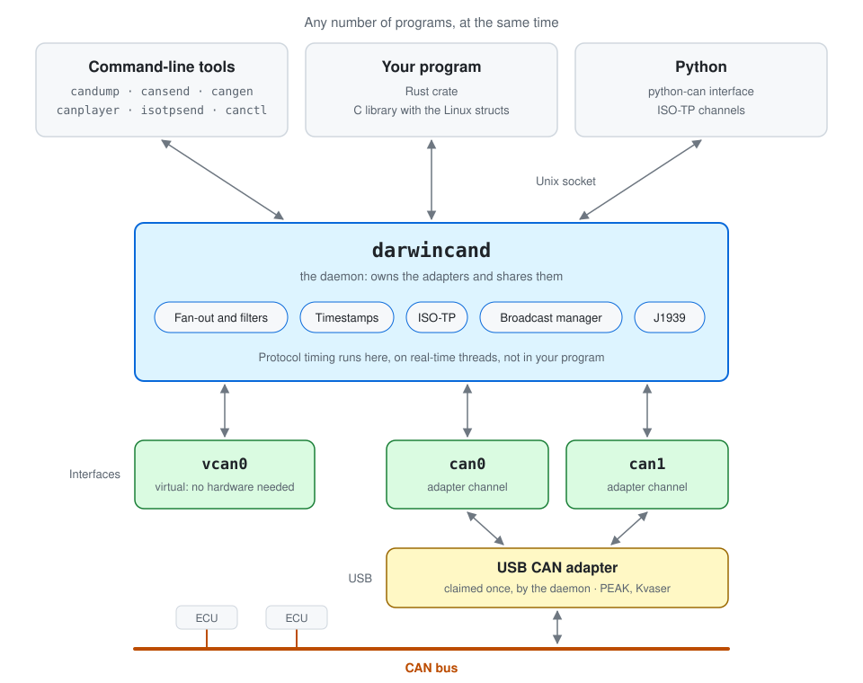

# Design

This page describes how darwinCAN is built and why. Read it before changing the daemon, and when you need to know exactly what a timestamp or a "sent" report means.

The decisions summarised here were made one at a time. The dated record, which includes what was tried and dropped, is in [notes/decisions.md](notes/decisions.md).

## The problem

macOS has no CAN stack, and it lets only one process claim a USB device. The CAN libraries that exist for the Mac (the adapter makers' own, and MacCAN) therefore open the adapter from inside one application, which then has it to itself. On Linux the kernel solves this: SocketCAN gives every program its own socket on a shared interface, with filters, timestamps and protocols such as ISO-TP inside the kernel.

darwinCAN puts a daemon where Linux has the kernel.

<picture>
  <source media="(prefers-color-scheme: dark)" srcset="images/architecture-dark.svg">
  
</picture>

darwinCAN is not the Linux interface. There is no `AF_CAN` socket family, the interfaces are names inside the daemon and not network interfaces, and a program that calls `socket(PF_CAN, ...)` does not build unchanged. What carries over is the model and the data: the encoding of frames, flags, filters and error frames, the socket options, the protocols, and the tools with their command lines.

## Parts

| Crate | Licence | Role |
|---|---|---|
| `darwincan-core` | MIT OR Apache-2.0 | Frames, filters, bus settings, and the wire protocol between daemon and clients |
| `darwincan-isotp` | MIT OR Apache-2.0 | ISO 15765-2 as a state machine, with no I/O and no clock |
| `darwincan-j1939` | MIT OR Apache-2.0 | SAE J1939 for one interface (addressing, address claims, BAM, RTS/CTS, the extended transport protocol), with no I/O and no clock |
| `darwincan` | MIT OR Apache-2.0 | The client library: a Rust library that is also built as a C library, with the header `darwincan.h` |
| `darwincan-utils` | MIT OR Apache-2.0 | The command-line tools |
| `darwincand` | GPL-2.0-only | The daemon: interfaces, fan-out, sessions, protocol timing, hardware backends |
| `python/` | MIT OR Apache-2.0 | The Python package, which is built on the C library |

### Why two licences

The hardware backends are derived from the Linux kernel's CAN drivers, which are GPL-2.0, so the daemon is GPL-2.0-only. Everything a program links against is permissively licensed, and a program talks to the daemon over a socket and does not link to it. An application built on darwinCAN is therefore free to use any licence.

This boundary is kept strictly: backend code lives only in `darwincand`, and the permissive crates never depend on it. The J1939 stack is written from the SAE standards and not from the kernel's implementation, so that it can live in a permissive crate.

## Clients and the wire protocol

A client connects to a Unix stream socket, by default `~/Library/Application Support/darwincan/darwincand.sock` (`DARWINCAN_SOCKET` overrides it). One connection is one socket: its first message says what it is (a raw socket on an interface, an ISO-TP channel, a broadcast manager, a J1939 socket, or a control session), and from then on it carries frames or messages of that kind.

Each message consists of an 8-byte header (type, protocol version, payload length) followed by a payload. All the messages are defined in `crates/darwincan-core/src/wire.rs`.

- **Sending a frame is fire-and-forget.** The call returns once the daemon has the frame, like `write` on a Linux socket. A failure that appears later is reported as an error in the receive stream.
- **Everything else is acknowledged.** A change to a filter or an option, and a `Sync` request, are each answered with `Ok` in the frame stream, in order. A filter is therefore in effect when the call returns, and a flush returns when the daemon has handled everything sent before it. This lets tests be deterministic without sleeping.
- **Broadcast manager and J1939 requests can be refused**, so each is answered with `Ok` or `Refused`. A J1939 send is acknowledged because only the daemon knows whether a NAME currently has an address.
- **The protocol version goes up with every change to a message.** The daemon and the client must match exactly. The daemon answers a client of a different version before it closes the connection, so that both sides can say what is wrong.

The protocol is an internal interface between parts that are built together. The supported programming interfaces are the Rust library, the C library and the Python package.

### Trust and limits

The daemon trusts every program that can open its socket. The socket is created for its owner alone, so by default that means every program running as the same user; there is no finer access control (see [SECURITY.md](../SECURITY.md)).

A client that is faulty, or that never reads what it is sent, must still not be able to stop the daemon or hold up other clients. The following limits make sure of that:

| Limit | Value | What happens beyond it |
|---|---|---|
| Messages queued for one client | 16,384 | Frames for that client are dropped and counted |
| Filters on a raw or J1939 socket | 512 | The request is refused |
| Transmit jobs, and receive jobs, per broadcast manager | 4,096 each | The request is refused |
| Frames in one broadcast manager job | 256 | The request is refused |
| Payload of a message carrying ISO-TP or J1939 data | 128 MiB | The connection is closed |
| ISO-TP and J1939 data one connection has given the daemon to send | 128 MiB, and always one message | The daemon stops reading from that client until there is room, so its send waits |
| ISO-TP and J1939 data waiting for one client to read | 128 MiB, and always one message | Further messages for that client are dropped |
| ISO-TP and J1939 data held for all clients together | 1 GiB (`--memory-limit`), half of it kept for sending | A client that sends waits; a client that already has data waiting loses further messages |
| Payload of any other message | 64 KiB | The connection is closed |
| Longest ISO-TP message a channel can be set to accept | 128 MiB | The channel is not opened |
| Time an answer waits for room in a client's queue, when it comes from a thread shared with other clients | 100 ms | The client is disconnected |

The last three rows count bytes, where the others count messages. A long message is counted when its header arrives, before the daemon reads the rest of it, and until it has been sent or given up; a received message is counted until it has been written to its client. CAN frames are not counted: they are small and their queues are limited by number, so nothing is added to the frame path. A client that reads what it is sent always gets its next message, whatever other clients leave unread.

The daemon takes blocks of a megabyte or more from the system directly and gives them back the moment they are freed (`large_alloc.rs`). The system allocator on macOS keeps freed large blocks for later use, and with it the daemon held several hundred megabytes after a few long messages for as long as it ran.

The daemon raises its own limit on open files at start-up, and a connection that cannot be accepted or served is dropped without affecting the others.

The client library has a matching limit: a program that sends but never receives has at most 16,384 received events kept for it, after which the oldest frames are discarded and counted as lost.

## The frame path

Inside the daemon, an interface is a `Bus`: a set of sinks (one per client socket, ISO-TP channel, broadcast manager or J1939 stack) and, for a hardware interface, a backend.

- A frame from a client is handed to the backend and, on a virtual interface, delivered to the other sinks at once.
- A frame from an adapter is delivered to every sink whose filters pass it.
- **Nothing on this path blocks.** A sink whose client reads too slowly drops frames and counts them; it never delays the bus or another client. A program can read the count of frames it has lost.

### Transmit confirmation

On a hardware interface, a frame is shown as sent only when the adapter reports that it was on the bus and was acknowledged, and it is then shown with the adapter's timestamp. This holds both for the sender, which sees its own frame when it has receive-own-messages turned on, and for other local sockets, which see the frame by loopback. A frame that nobody acknowledges is not shown.

The backend asks the adapter for such a report for every frame. Frames that are still with the adapter when an interface goes down are dropped, without an error for each one, as on Linux; an ISO-TP transfer that is in progress then fails.

A backend lets an adapter hold a limited number of unsent frames. Beyond that number, a send waits up to 500 ms for room and is then refused. This is the one place where sending can wait, and it is why a flush can take that long when it follows a frame that cannot go out.

## Timing

Timing is treated as a feature, not as best effort.

### Timestamps

Every frame is timestamped once, in the daemon, and every client sees the same timestamp for the same frame. The timestamp counts nanoseconds since the Unix epoch on a clock that never steps. Differences between timestamps do not depend on when a client is scheduled or how late it reads.

A hardware backend uses the adapter's own timestamp, which is the end of the frame on the wire. The adapter's clock is mapped onto the daemon's by `TimeSync`. It keeps the smallest delay seen between a message's timestamp and its arrival, on the reasoning that the quickest delivery is the one closest to the truth, and it bounds how fast the two clocks can drift apart.

Two properties follow, and both are deliberate:

- **A timestamp is never early.** It can read late, by as much as the quickest recent delivery was slow (up to about a millisecond on a quiet bus with some adapters), but an estimate that could run ahead would let protocol timing undercut its limits. An earlier estimator that looked more accurate was removed for exactly that reason.
- **A whole USB transfer is examined before any frame in it is stamped**, so that frames sharing a transfer do not each shift the estimate.

### Protocol timing runs in the daemon

ISO-TP flow control and STmin, the broadcast manager's cyclic jobs, and the J1939 transport protocols all run inside the daemon. None of them waits for a round trip to a client, so a program that is busy or descheduled does not shift the time at which a frame goes onto the bus. The protocol engines themselves (`darwincan-isotp`, `darwincan-j1939`, the daemon's `bcm` module) do no I/O and read no clock: the caller passes the time in and takes frames out, which lets their timing be tested to the nanosecond.

**STmin is a strict lower bound.** With transmit confirmation, the gap before the next consecutive frame is counted from the adapter's report of the previous one, which is the end of that frame. The gap on the bus is then never shorter than STmin; it is longer by the time the report takes to arrive. Handing frames to the adapter early by a measured margin was tried, but it undercut STmin once in 35,000 frames, so it is not done.

### Real-time threads

macOS wakes an ordinary thread from a timed wait a millisecond or more late, and now and then it holds one up for 5 to 20 ms. The daemon's threads that move frames or time protocols therefore run in the real-time scheduling class, where a thread wakes within tens of microseconds of the time it asked for. That includes the USB library's own delivery thread. The tools that pace frames (`cangen`, `canplayer`) do the same.

`canctl latency vcan0` measures client-to-client delivery through the daemon; a median well under 0.1 ms is normal.

## Hardware backends

A backend implements `darwincand::Backend` for one channel: `start` (which takes the bus settings), `stop` and `transmit`. It delivers received frames and transmit reports through the `InterfaceHandle` it was given when the interface was registered. Protocol encoding and decoding are pure functions in each backend's `proto.rs`, tested against the layouts of the reference driver.

Around the backends, the daemon provides the following:

- **Hotplug.** Supported adapters are attached when plugged in and removed when unplugged, and clients are told at once.
- **Names that last.** A backend gives each channel an identity made of the adapter's model, its serial number and the channel number. For an adapter that has no serial number of its own, the USB port it is plugged into takes the serial number's place. The interface name is kept under that identity in `~/Library/Application Support/darwincan/interfaces`.
- **Sleep.** Adapters lose their settings when the Mac sleeps. The daemon notices a wake and restores every interface that was up.
- **A clean start.** An adapter is taken off the bus when it is attached, in case a daemon that was killed left it running.
- **Bus-off.** An interface that has gone bus-off refuses frames until it is taken down and brought up again; the controller is not restarted behind the user's back.

An option that cannot be honoured is refused with a message. When listen-only is asked for on an adapter that has no listen-only mode, the adapter is not started in some other mode instead, because the difference is whether it puts anything on the bus.

## Compatibility with Linux

- `can_id` flag bits, CAN FD flags, filter matching and error frame classes follow `<linux/can.h>` and `<linux/can/error.h>` exactly.
- The C API uses the Linux structs and constants with their names and layouts, and its own `dcan_*` functions in place of the socket calls. There is deliberately no shim that would let Linux source compile unchanged: the calls differ enough that pretending otherwise would hide real differences.
- The broadcast manager follows `CAN_BCM` operation by operation and flag by flag; J1939 follows `CAN_J1939`'s socket model, with notices in place of Linux's socket error queue.
- The tools take the command lines of can-utils and `ip link` and print the same output. They are written from the tools' documented behaviour, not copied from their source.

The C guide lists the places where behaviour differs from Linux: see [c-api.md](c-api.md#where-it-behaves-differently).
